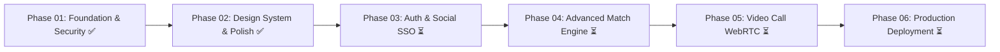

# SkillSwap – Development Roadmap

## Phase Overview & Milestones

---

### Phase 01: Foundation Audit, Security Correction & Git Workflow
- [x] Workspace structure and TypeScript monorepo configuration
- [x] Strict environment variable validation (`JWT_SECRET` min 16 chars)
- [x] Enforce `ProtectedRoute` and `AdminRoute` on client
- [x] Backend role-based authorization (`requireRole(['admin'])`)
- [x] Input validation for registration & login (email regex, password length, role whitelist)
- [x] Password hashing verification (`bcryptjs`)
- [x] Fix category route mapping (`/api/categories`)
- [x] Automated 24-point foundation test suite (`npm run test:foundation`)
- [x] Git workflow setup: `main` (production), `develop` (integration)

---

### Phase 02: UI Design System, Complete Screen Refinement & Responsive Optimization
- [x] Comprehensive UI/UX audit across all 15 screens (`docs/PHASE_02_UI_AUDIT.md`)
- [x] Design tokens for Forest Green (`#0F4C3A`), Warm Cream (`#FCFBF7`), Action Orange (`#FF6B00`)
- [x] Reusable component library (`Input`, `Textarea`, `Select`, `Toast`, `Skeleton`, `EmptyState`, `ConfirmationDialog`, `Avatar`, `Breadcrumbs`, `Pagination`)
- [x] Off-canvas mobile navigation drawer with backdrop overlay and auto-dismiss
- [x] Mobile header with hamburger menu button and expandable search
- [x] Mobile 2-view switcher for Real-Time Chat (`ChatPage.tsx`)
- [x] Elimination of all synchronous native alerts (`alert(...)`, `window.confirm(...)`)
- [x] Responsive data tables with horizontal scroll containers
- [x] Responsive Recharts scaling across 1440px, 1024px, 768px, and 390px viewports
- [x] Clean production builds for client and server (`npm run build`)
- [x] Regression testing: all 24 foundation tests passing

---

### Phase 03: Authentication & Account Security Enhancements
- [ ] Google OAuth 2.0 and GitHub SSO integration
- [ ] Email verification flow and password reset via secure one-time tokens
- [ ] Two-Factor Authentication (2FA) optional TOTP

---

### Phase 04: Advanced Matching & Recommendation Engine
- [ ] Vectorized cosine similarity matching for multi-skill portfolios
- [ ] Timezone-aware mutual availability scheduling
- [ ] Proximity-based filtering with geolocation coordinates

---

### Phase 05: Real-Time Multimedia Collaboration
- [ ] In-browser WebRTC audio/video call integration alongside Google Meet
- [ ] Collaborative real-time whiteboard / code editor in active sessions
- [ ] File and code snippet attachments in Socket.IO chat

---

### Phase 06: Production Hardening, CI/CD & Deployment
- [ ] GitHub Actions automated test & build workflows
- [ ] Docker containerization for client and server
- [ ] Performance monitoring and CDN asset distribution
