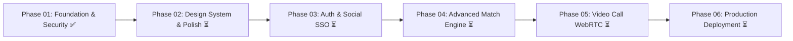

# SkillSwap – Development Roadmap

## Phase Overview & Milestones

---

### Phase 01: Foundation Audit, Security Correction & Git Workflow (Current)
- [x] Workspace structure and TypeScript monorepo configuration
- [x] Strict environment variable validation (`JWT_SECRET` min 16 chars)
- [x] Enforce `ProtectedRoute` and `AdminRoute` on client
- [x] Backend role-based authorization (`requireRole(['admin'])`)
- [x] Input validation for registration & login (email regex, password length, role whitelist)
- [x] Password hashing verification (`bcryptjs`)
- [x] Fix category route mapping (`/api/categories`)
- [x] Automated 24-point foundation test suite (`npm run test:foundation`)
- [x] Git workflow setup: `main` (production), `develop` (integration), `chore/project-foundation`

---

### Phase 02: Design System Refinement & Accessibility
- [ ] Responsive UI audit across mobile, tablet, and desktop breakpoints
- [ ] Color contrast compliance (WCAG 2.1 AA) for warm cream & forest green themes
- [ ] Custom toast notifications system
- [ ] Skeleton loaders for dashboard cards and partner discovery

---

### Phase 03: Authentication & Account Security Enhancements
- [ ] Google OAuth 2.0 and GitHub SSO integration
- [ ] Email verification flow and password reset via secure one-time tokens
- [ ] Two-Factor Authentication (2FA) optional TOTP

---

### Phase 04: Advanced Matching & Recommendation Engine
- [ ] Vectorized cosine similarity matching for multi-skill portfolios
- [ ] Timezone-aware mutual availability scheduling
- [ ] Proximity-based filtering with geolocation coordinates

---

### Phase 05: Real-Time Multimedia Collaboration
- [ ] In-browser WebRTC audio/video call integration alongside Google Meet
- [ ] Collaborative real-time whiteboard / code editor in active sessions
- [ ] File and code snippet attachments in Socket.IO chat

---

### Phase 06: Production Hardening, CI/CD & Deployment
- [ ] GitHub Actions automated test & build workflows
- [ ] Docker containerization for client and server
- [ ] Production database indexing and Redis caching for match queries
- [ ] Cloud deployment (Vercel / Railway / AWS)
