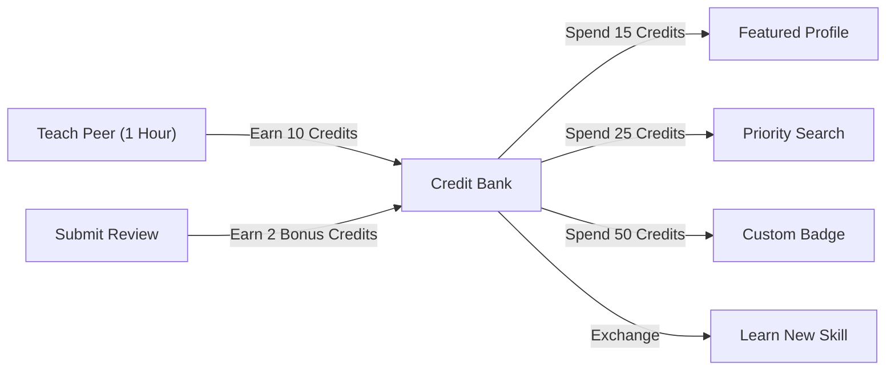
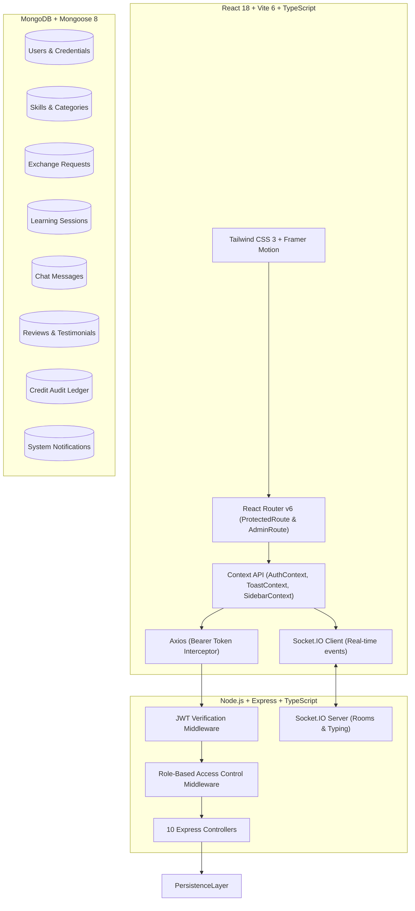

# SkillSwap – Knowledge Exchange Network: Master Architecture Blueprint

**Document Version:** 3.0  
**Status:** Phase 01–03 Completed | Phase 04–06 Planned  
**Project Path:** `D:\EQI_git_projects\SkillSwap`  
**Repository:** `https://github.com/mahesh-vulleru/skill-swap`  

---

## 1. Executive Summary & Vision

**SkillSwap** is a peer-to-peer knowledge exchange platform designed as a modern educational SaaS application. Rather than trading money, members trade time and expertise in a reciprocal credit-banking economy.

- **Core Metric:** 1 Hour of Teaching = 10 Credits Earned (+15 Reputation Points).
- **Core Incentive:** Writing Verified Reviews = +2 Reviewer Bonus Credits.
- **Credit Utility:** Credits are spent to unlock premium visibility, verified badges, and priority search placement.



---

## 2. Technology Stack & System Architecture



### Complete Technology Inventory
| Tier | Technologies | Role / Purpose |
| :--- | :--- | :--- |
| **Frontend UI** | React 18, Vite 6, TypeScript | High-performance SPA with strict typing |
| **Styling** | Tailwind CSS 3, Lucide React Icons | Modern SaaS design system with standardized color tokens |
| **Animations** | Framer Motion | Smooth transitions, modal overlays, card hovers |
| **Visualizations**| Recharts | Interactive SVG area charts, bar graphs, and KPIs |
| **Routing** | React Router v6 | Layout separation (`AppLayout` vs `AdminLayout`), route guards |
| **State Management**| React Context API | `AuthContext` (auth & profile), `ToastContext` (notifications), `SidebarContext` (mobile drawer) |
| **Backend API** | Node.js v24, Express.js, TypeScript | RESTful API server with modular controllers |
| **Database** | MongoDB 7.0, Mongoose ODM | Document storage with schemas, indexes, and aggregation pipelines |
| **Real-Time** | Socket.IO | Bidirectional messaging, typing indicators, active notifications |
| **Authentication**| JWT (JSON Web Tokens), bcryptjs | 7-day signed tokens, salt-hashed passwords, role enforcement |

---

## 3. Blueprint of Completed Implementations (Phases 1–3)

### A. Phase 1: Security Foundation & RBAC (Completed)
- Mandatory environment validation (`JWT_SECRET` min 16 characters).
- Enforced `ProtectedRoute` (blocking unauthenticated visitors) and `AdminRoute` (blocking non-admins).
- Strict backend role authorization (`requireRole(['admin'])`).
- Input validation (email regex, password length >= 6 characters, role injection prevention).
- Password omitted from all user query responses.
- 24/24 automated security & foundation tests passing.

### B. Phase 2: Design System & 15 Responsive Screens (Completed)
- Standardized design tokens:
  - **Forest Green:** `#0F4C3A` (Primary brand, navigation, badges)
  - **Warm Cream:** `#FCFBF7` (Background surfaces, high readability)
  - **Action Orange:** `#FF6B00` (Call-to-action buttons, highlights)
- Reusable component library: `Button`, `Card`, `Badge`, `Modal`, `Input`, `Textarea`, `Select`, `Toast`, `Skeleton`, `EmptyState`, `ConfirmationDialog`, `Avatar`, `Breadcrumbs`, `Pagination`.
- Fully responsive across desktop (1440px), laptop (1024px), tablet (768px), and mobile (390px) with off-canvas sidebar drawer.
- Zero intrusive native browser `alert()` or `window.confirm()` popups (replaced with accessible custom dialogs).

### C. Phase 3: Dashboard Separation & Complete Workflow Integration (Completed)
- **Portal Separation:**
  - **User Portal (`AppLayout` + `Sidebar`):** 10 pure learning and exchange modules.
  - **Admin Portal (`AdminLayout` + `AdminSidebar`):** 6 governance modules.
  - **Context Switcher:** Exclusive toggle buttons for administrators to transition between portals.
- **Hardened Business Guardrails:**
  - Blocked self-exchanges, self-scheduling, self-reviews, and self-messages.
  - Blocked duplicate pending exchange requests.
  - Enforced that only the intended recipient can accept/decline exchange proposals.
  - Enforced that only session participants can update session statuses.
  - Blocked re-completing sessions to prevent duplicate credit awards.
  - Blocked duplicate reviews for the same completed session.
- **Closed-Loop Workflow Connections:**
  - `Matches` / `Exchanges` $\rightarrow$ `Chat/:userId` (automatic partner selection).
  - `Exchanges` $\rightarrow$ `Schedule` (auto pre-populates partner and skill).
  - `My Sessions` (Completed) $\rightarrow$ `Reviews` (auto pre-populates partner, skill, and session ID).
  - Review submission awards +2 reviewer credits and updates partner's community rating.
- **46/46 Automated Tests Passing:** 24 Foundation + 22 Phase 3 Workflow Integration tests.

---

## 4. Complete Module & Feature Matrix

### User Dashboard Portal (10 Modules)
```
User Dashboard Portal
├── 1. Overview Dashboard (/dashboard)
│   ├── Learning Streak Counter
│   ├── Credit Balance Widget
│   ├── Skills Offered & Wanted Summary
│   ├── Recommended Partners Widget (with compatibility score)
│   └── Upcoming Sessions Agenda
├── 2. Profile & Skills (/profile)
│   ├── Public Bio & Geographic Location
│   ├── Availability Schedule
│   ├── Skills I Teach (Offered) CRUD
│   └── Skills I Learn (Wanted) CRUD
├── 3. Explore Skills (/skills)
│   ├── Real-time Keyword Search
│   ├── Category Filter Chips (Development, Design, Marketing, etc.)
│   ├── Experience Level Dropdown (Beginner, Intermediate, Advanced)
│   └── Direct "Find Peer Mentors" action
├── 4. Compatibility Matching (/matches)
│   ├── Mutual Compatibility Match % Calculation
│   ├── Category Tabs
│   ├── Direct "Chat" Button (routes to /chat/:partnerId)
│   └── "Send Exchange Proposal" Modal
├── 5. Exchange Requests Hub (/exchange-requests)
│   ├── Status Filter Tabs (Pending, Accepted, Rejected, Completed)
│   ├── Incoming Proposals (Accept / Decline actions)
│   ├── Outgoing Proposals (Awaiting response badge)
│   └── "Schedule Session" action on accepted swaps
├── 6. Schedule Session (/schedule)
│   ├── Peer Partner Selector (Pre-fills from URL)
│   ├── Skill & Topic Definition
│   ├── Date, Time & Duration Picker
│   ├── Mode Selector (Google Meet, Zoom, Live Video)
│   └── Unique Google Meet Video Room Generation
├── 7. My Learning Sessions (/my-sessions)
│   ├── Tabs (Upcoming, Ongoing, Completed, Cancelled, All)
│   ├── "Join Google Meet" Launch Button
│   ├── "Mark Completed" Button (+10 credits to mentor)
│   ├── "Cancel Session" with Confirmation Dialog
│   └── "Leave Review" Button (pre-fills review modal)
├── 8. Real-Time Knowledge Chat (/chat, /chat/:userId)
│   ├── Active Conversations Directory
│   ├── Socket.IO Instant Direct Messaging
│   ├── Live Delivery Timestamps & Unread Badges
│   └── Mobile 2-View Switcher (Conversations List <-> Active Chat)
├── 9. Reviews & Reputation (/reviews)
│   ├── Verified Reputation Score (e.g. 4.9 / 5.0)
│   ├── Unlocked Achievement Badges (Top Mentor, Community Star)
│   ├── Interactive 5-Star Testimonial Submission Modal
│   └── Automated +2 Reviewer Bonus Credit Grant
└── 10. Credits Economy & Rewards (/credits)
    ├── Current Balance, Total Earned, Total Spent
    ├── Paginated Audit Transaction Ledger (Earned, Spent, Bonus, Refund)
    └── Perk Redemption Store (Featured Profile, Priority Search, Badge)
```

### Administrative Portal (6 Modules)
```
Administrative Portal
├── 1. Admin Overview (/admin)
│   ├── Platform KPIs (Total Users, Active Swaps, Sessions, Reviews)
│   ├── Server Health & Uptime Indicators
│   ├── Real-time Activity Stream
│   └── Database Connectivity Status
├── 2. User Directory & Governance (/admin/users)
│   ├── Member Search & Role Filters
│   ├── Account Status Modifiers (Active / Suspended / Banned)
│   ├── Role Promotion & Demotion (User <-> Admin)
│   └── Self-Demotion / Self-Ban Guardrails
├── 3. Platform Growth Analytics (/admin/analytics)
│   ├── Category Popularity Distribution Breakdown
│   ├── Exchange Completion Conversion Funnel
│   └── Monthly Active User & Swap Velocity Recharts
├── 4. Moderation & Dispute Queue (/admin/moderation) [Phase 4]
│   ├── Flagged Chat Content Review
│   ├── Disputed Session Claims & Resolution
│   └── Automatic Penalty Enforcement
├── 5. Platform Configuration (/admin/settings) [Phase 4]
│   ├── Credit Economy Constants (Session Award, Review Bonus)
│   ├── Platform Maintenance Mode Toggle
│   └── SMTP / Email Gateway Configuration
└── 6. Security Audit Logs (/admin/audit-logs) [Phase 4]
    ├── Immutable Administrative Event Ledger
    ├── IP Telemetry & Sign-in Audit Trail
    └── Permission Modification History
```

---

## 5. What Is Remaining (Phases 4–6 Roadmap)

```mermaid
flowchart TD
    subgraph Phase 04 [Phase 04: Advanced Match Engine & Admin Backend]
        P4_1["Backend for Moderation Queue (/api/admin/moderation)"]
        P4_2["Backend for System Settings (/api/admin/settings)"]
        P4_3["Backend for Immutable Audit Logs (/api/admin/audit-logs)"]
        P4_4["Vectorized Cosine Similarity Matching Algorithm"]
        P4_5["Timezone-Aware Mutual Availability Calendar"]
    end

    subgraph Phase 05 [Phase 05: Real-Time Multimedia Collaboration]
        P5_1["In-Browser WebRTC Peer-to-Peer Video Call"]
        P5_2["Live Interactive Whiteboard & Code Editor"]
        P5_3["File & Snippet Attachments in Chat"]
    end

    subgraph Phase 06 [Phase 06: Production Hardening & CI/CD]
        P6_1["GitHub Actions Automated CI/CD Pipeline"]
        P6_2["Docker Multi-Stage Containerization"]
        P6_3["Redis Caching Layer for Matching & Sessions"]
        P6_4["Production Cloud Deployment (AWS / GCP / Vercel)"]
    end

    Phase 04 --> Phase 05 --> Phase 06
```

### Breakdown of Remaining Work:
1. **Phase 4 – Administrative Backend & Advanced Recommendation:**
   - **Moderation Backend:** Create `Report` model and controllers for handling flagged messages and disputed sessions.
   - **Platform Settings Backend:** Create `PlatformConfig` model to allow dynamic credit economy adjustments without code deploys.
   - **Audit Log Backend:** Create `AuditLog` model recording every admin status change, role change, and deletion.
   - **Enhanced Matching:** Calculate match affinity using multi-skill weighting and timezone overlap.
2. **Phase 5 – Real-Time Multimedia:**
   - Embed WebRTC video directly into `/my-sessions` so users don't need external Google Meet links.
   - Add a collaborative code scratchpad during live sessions.
3. **Phase 6 – Production Deployment:**
   - Containerize client and server via Docker Compose.
   - Setup GitHub Actions running the 46 automated tests on every push.
   - SSL/TLS certification, rate limiting, and Redis session caching.

---

## 6. What Changes Are Needed Right Now?

### A. Code & Workflow Assessment: Is Anything Broken?
- **Workflow Integrity:** **NO changes needed.** The 10-step user flow and admin governance are operating with 100% test passing rates.
- **UI & Design:** **NO changes needed.** The responsive layouts, design tokens, modals, and toasts adhere strictly to the project moodboard and SaaS standards.
- **Database & Business Logic:** **NO changes needed.** All guardrails (preventing self-swaps, duplicate requests, non-recipient acceptance, and unauthorized status modifications) are actively enforced.

### B. Immediate Operational Actions Required:
1. **Git Commit:** Stage all modified controllers, pages, and documentation on branch `feat/dashboard-workflow-integration`.
2. **Git Push:** Push the branch to `origin/feat/dashboard-workflow-integration`.
3. **Open Pull Request:** Open PR targeting `develop` titled:  
   `feat(phase-03): separate dashboards and integrate complete user and admin workflows`.
4. **Transition to Phase 4:** Proceed to implementing backend persistence for the 3 scaffolded admin tools and advanced matching.

